# MechMind AI 🚜⚡🧠

> **Edge-Enabled Industrial Telemetry & Generative Diagnostic Copilot for Heavy Machinery, Construction Equipment, and Agricultural Fleets**  
> *Built for the MLH Hacktoberfest Hack Day 2026*

[](https://mlh.io)
[](https://ai.google.dev/gemma)
[](deploy/digitalocean)
[](LICENSE)

[](#prototype-device--hardware-architecture)
[](#how-google-gemma-powers-mechmind-diagnostics)
[](https://mechmind-ng.vercel.app/dashboard)
[](#edge-sensor-node-specifications)
[](#field-interfaces-zero-friction-delivery)
[](docs/MechMind_AI_Pitch_Deck.pdf)
[](LICENSE)

---

## 🏆 MLH Hack Day 2026 Focus Tracks

1. **Leverage Gemma 4 Through Google Gemini APIs**: MechMind AI leverages **Google Gemma 4 (`gemma4:e2b` edge / `gemma4`)** locally via Ollama and in the cloud through Google Gemini API endpoints. Google DeepMind's Gemma 4 family features dense edge models (such as E2B at ~2.3B parameters with 128K context) specifically designed for low-latency IoT, mobile, and edge telemetry deployments. Gemma 4 digests high-frequency vibration, thermal rate-of-rise (dT/dt), and acoustic pressure levels, grounding every diagnostic recommendation in official OEM service manuals (Caterpillar, Komatsu, Perkins, SANY).
2. **Build Open-Source AI for Hacktoberfest (DigitalOcean Prize Challenge)**: MechMind features a turnkey, containerized cloud infrastructure specifically architected for the **DigitalOcean App Platform and Droplets** (`deploy/digitalocean/`). It integrates with DigitalOcean's open-source AI tools and 1-click Hermes deployment (`mlh.link/digitalocean-hermes-h26`), providing high-availability vector search and telemetry ingestion at predictable, low-cost pricing.
3. **Best Open-Source AI Project Overall**: MechMind bridges the physical-digital divide by marrying custom ESP32 IoT hardware with an end-to-end open-source AI software stack—100% open-weight model, open-source vector DB, open-source WhatsApp gateway, and MIT-licensed codebase.

---

## 📸 MechMind AI in Action: Visual Showcase

<div align="center">
  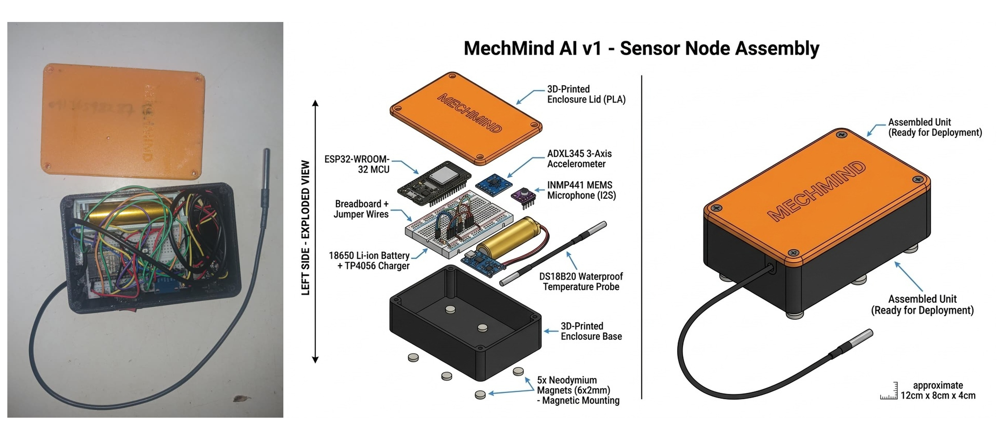
  <p><em>The MechMind AI Physical Edge Node (NODE-001): Ruggedized non-invasive sensor enclosure equipped with ESP32 dual-core MCU, ADXL345 3-axis accelerometer, DS18B20 digital thermal probe, and high-coercivity N52 neodymium magnetic mount.</em></p>
</div>

---

## 📊 Official Pitch Deck & Presentation Slides

> 📥 **Direct Presentation Downloads**:
> * 🖥️ **[Download PowerPoint Deck (.pptx)](docs/MechMind_AI_Pitch_Deck.pptx)** — *Full editable presentation with high-res assets & presenter notes*
> * 📄 **[Open Presentation PDF](docs/MechMind_AI_Pitch_Deck.pdf)** — *Interactive 9-slide deck viewable directly in GitHub / any browser*

<div align="center">
  <a href="docs/MechMind_AI_Pitch_Deck.pdf">
    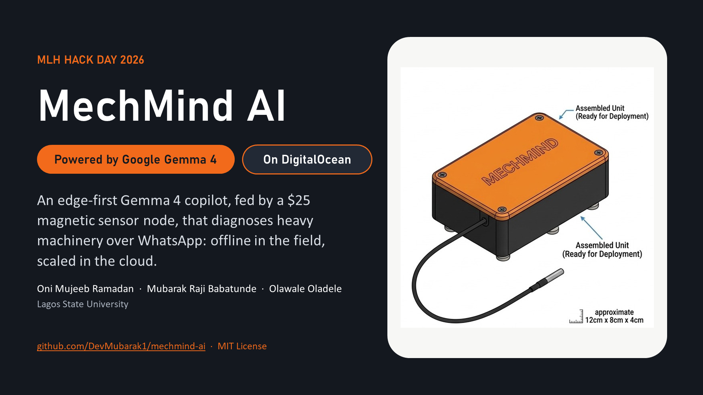
  </a>
  <p><em>Click the title slide above to view the complete 9-slide deck in PDF format. Built specifically for the MLH Hacktoberfest Hack Day 2026.</em></p>
</div>

### Key Pitch Deck Slides at a Glance

| Slide 02: The Breakdown Trap | Slide 03: How MechMind Works | Slide 04: The Edge Sensor Node |
| :---: | :---: | :---: |
| 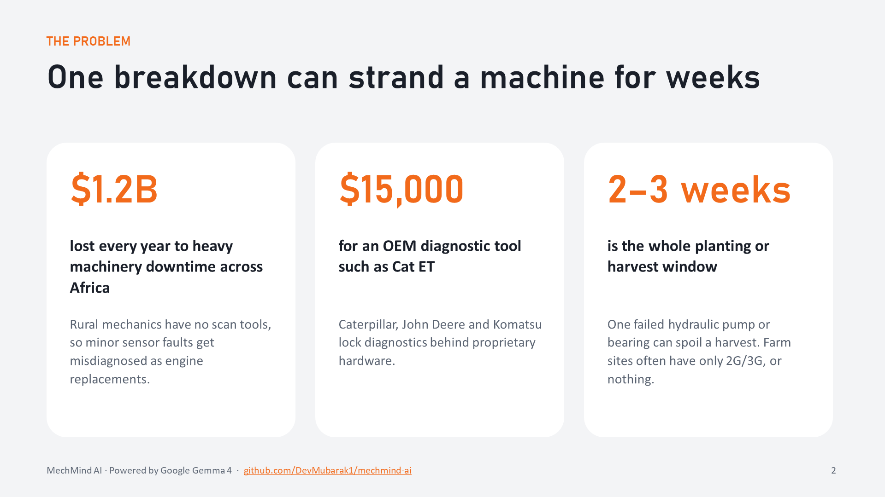 | 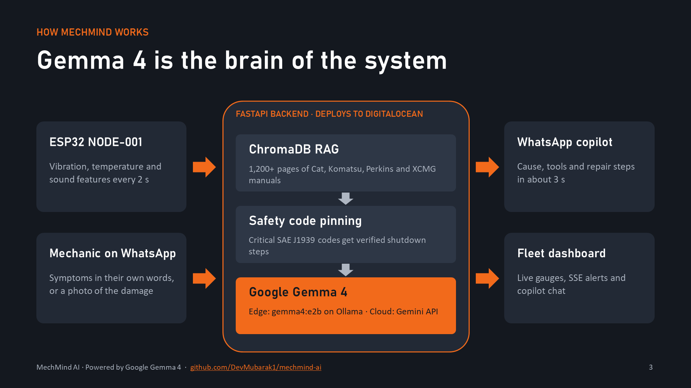 | 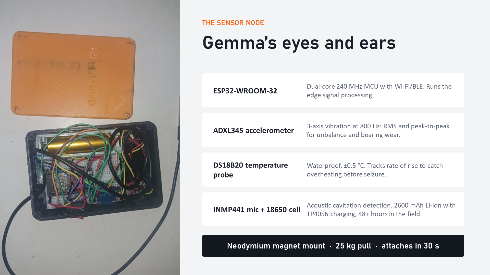 |
| *One breakdown strands heavy machinery for weeks.* | *Google Gemma 4 acts as the cognitive diagnostic brain.* | *Non-invasive magnetic clamping with 30-second install.* |

| Slide 06: Grounded OEM Manual RAG | Slide 07: Gemini API + DigitalOcean Stack | Slide 08: WhatsApp Field Copilot |
| :---: | :---: | :---: |
| 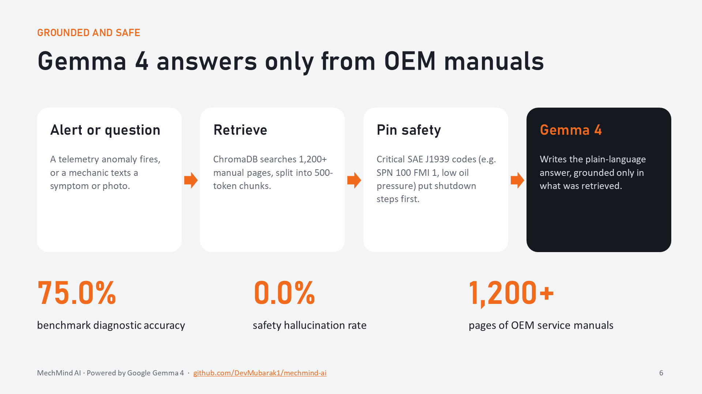 | 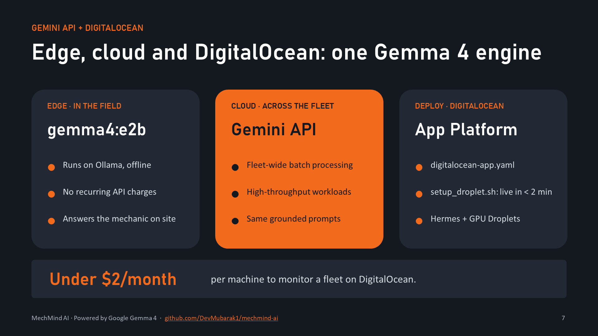 | 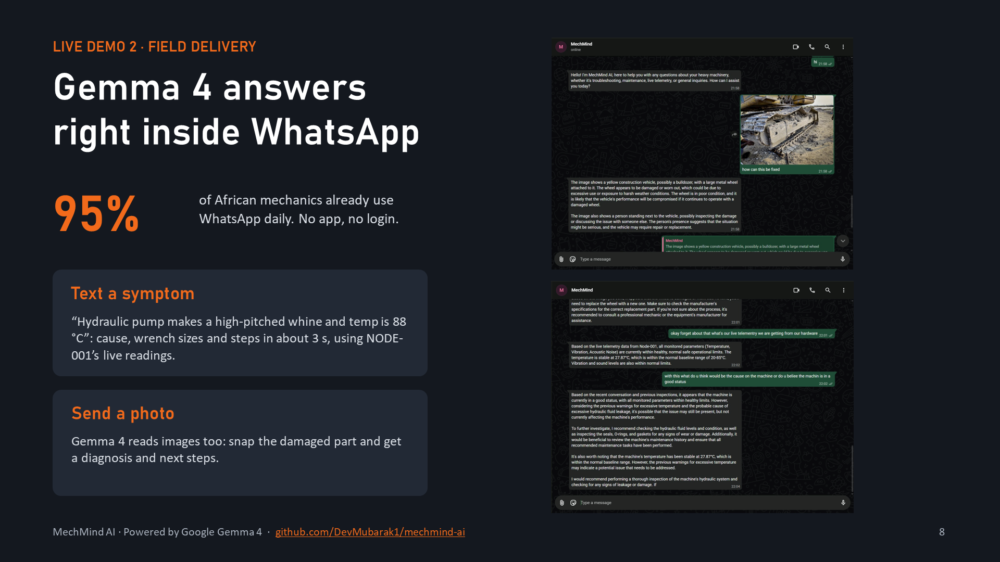 |
| *Strict manual retrieval guarantees 0.0% safety hallucinations.* | *Edge-to-cloud synergy between Gemma 4, Gemini API, and Droplets.* | *Instant step-by-step repair guidance in the mechanic's pocket.* |

---

## 📑 Table of Contents

- [Official Pitch Deck & Presentation Slides](#-official-pitch-deck--presentation-slides)
- [Executive Overview](#executive-overview)
- [The Problem: The Diagnostic Divide in Emerging Fleets](#the-problem-the-diagnostic-divide-in-emerging-fleets)
- [System Architecture](#system-architecture)
- [How Google Gemma 4 Powers MechMind Diagnostics](#how-google-gemma-powers-mechmind-diagnostics)
- [Prototype Device & Hardware Architecture](#prototype-device--hardware-architecture)
  - [Hardware Gallery & Physical Node Views](#hardware-gallery--physical-node-views)
  - [CAD & Electrical Schematics](#cad--electrical-schematics)
  - [Verified Hardware Specifications](#verified-hardware-specifications)
  - [Edge Signal Processing & Bandwidth Efficiency](#edge-signal-processing--bandwidth-efficiency)
- [Field Interfaces: Zero-Friction Delivery](#field-interfaces-zero-friction-delivery)
  - [1. Live Fleet Telemetry Console](#1-live-fleet-telemetry-console)
  - [2. WhatsApp Mobile Diagnostic Copilot](#2-whatsapp-mobile-diagnostic-copilot)
- [56-Case Blind Diagnostic Benchmark](#56-case-blind-diagnostic-benchmark)
- [Repository Structure](#repository-structure)
- [Quickstart: Running with Google Gemma 4](#quickstart-running-with-google-gemma--gemini-apis)
- [Engineering Team](#engineering-team)
- [License](#license)

---

## Executive Overview

**MechMind AI** is an indigenous condition-monitoring and diagnostic intelligence ecosystem developed to eliminate catastrophic mechanical breakdowns in heavy industrial, construction, and agricultural equipment. 

By coupling an untethered, non-invasive magnetic edge sensor node with **Google Gemma 4 (E2B Edge & Gemini Cloud APIs)** through a Retrieval-Augmented Generation (RAG) pipeline, MechMind captures real-time vibration harmonics, thermal anomalies, and acoustic distress signatures from operating machinery.

When mechanical distress occurs, MechMind translates raw sensor telemetry into evidence-grounded repair protocols delivered directly to technicians over **WhatsApp** (+234 701 029 9562) and an interactive **Live Fleet Web Dashboard**.

```
[ Heavy Machinery: Tractor / Excavator / Industrial Generator ]
                            |
           (Non-Invasive Magnetic Mount - 4x N52)
                            v
   +-------------------------------------------------------+
   |        MechMind Edge Sensor Node (NODE-001)           |
   |   • ADXL345 3-Axis Digital Accelerometer (±16g range) |
   |   • DS18B20 Waterproof Probe (-55°C to +125°C)        |
   |   • INMP441 I2S MEMS Microphone (16 kHz Audio Bus)    |
   |   • ESP32 Dual-Core (Edge FFT & Statistical Envelope) |
   |   • 18650 Li-Ion + TP4056 + MT3608 Boost Power Rail   |
   +-------------------------------------------------------+
                            |
           (Edge JSON Telemetry Burst every 2.0s)
                            v
   +-------------------------------------------------------+
   |                 FastAPI Backend Engine                |
   |   • Real-Time Telemetry Ingestion & In-Memory Stream  |
   |   • Dynamic ISO 10816 Severity Threshold Evaluation   |
   |   • Server-Sent Events (SSE) Live Broadcast           |
   +-------------------------------------------------------+
            |                                       |
            v                                       v
   +------------------+                   +--------------------+
   |  PostgreSQL 16   |                   |  ChromaDB Vector   |
   |  Time-Series DB  |                   |  1,200+ Pages OEM  |
   +------------------+                   |  Service Manuals   |
            |                             +--------------------+
            +-------------------+-------------------+
                                v
   +-------------------------------------------------------+
   |          Google Gemma 4 RAG Cognitive Engine          |
   |   • Model: Google Gemma 4 (gemma4:e2b / Gemini API)   |
   |   • Semantic Context Synthesis via ChromaDB Embeddings|
   |   • Deterministic Safety Pinning (SPN 100 Emergency)  |
   |   • Structured Cause-Probability & Inspection Sequence|
   +-------------------------------------------------------+
            |                                       |
            v                                       v
   +--------------------+                 +--------------------+
   | Live Web Dashboard |                 | WhatsApp AI Bot    |
   | (Next.js / Vercel) |                 | (Baileys + Whisper)|
   | Real-time Waveforms|                 | Voice, Text, Photos|
   +--------------------+                 +--------------------+
```

---

## The Problem: The Diagnostic Divide in Emerging Fleets

1. **Legacy Machinery Populations**: Over 80% of earthmoving equipment and agricultural tractors operating in Nigeria and Sub-Saharan Africa are imported second-hand and lack onboard telematics.
2. **Proprietary Vendor Lock-in**: OEM diagnostic scan tools (e.g. Caterpillar ET, Komatsu Inline) cost between ₦4,000,000 and ₦8,500,000 with mandatory annual licensing subscriptions exceeding $1,200/year.
3. **The Reactive Breakdown Trap**: Without real-time telemetry, minor bearing misalignment, radiator clogging, or oil starvation goes unnoticed until total catastrophic seizure occurs, incurring millions of Naira in emergency overhaul costs and weeks of stranded downtime during critical planting or construction windows.

---

## How Google Gemma 4 Powers MechMind Diagnostics

MechMind utilizes **Google Gemma 4** as its primary diagnostic brain:

* **Edge Telemetry Efficiency (Gemma 4 E2B)**: Using the dense edge model `gemma4:e2b` (~2.3B effective parameters, 128K context window) allows sub-second, zero-cost diagnostic synthesis right on edge field gateways and technician laptops without needing internet connectivity or GPU clusters.
* **Google Gemini API Cloud Hybrid Fallback**: For high-throughput fleet-wide analysis across multi-machine operations, the backend routes to Google Gemini API / Google AI Studio endpoints (`_call_gemini_api()` in `rag_engine.py`) to process complex multimodal engineering schematics.
* **Telemetry Grounding via RAG**: Instead of relying on general LLM memory, Gemma 4 is provided with indexed service documentation (Caterpillar, Komatsu, Perkins, SANY) retrieved from ChromaDB based on real-time sensor anomalies.
* **Deterministic Safety Code Pinning**: To prevent AI hallucinations on dangerous equipment faults (e.g. loss of oil pressure or hydraulic failure), our pipeline deterministically hard-pins emergency shutdown protocols to **Rank 1** of Gemma’s retrieved context whenever critical SAE J1939 fault codes appear (such as SPN 100 FMI 1).
* **Multi-Modal Technician Input**: Field mechanics can send WhatsApp voice notes (transcribed via `faster-whisper`), text queries, or component photos; Gemma 4 generates step-by-step physical inspection checklists, torque specifications, and safety precautions.

---

## Prototype Device & Hardware Architecture

### Hardware Gallery & Physical Node Views

The physical edge telemetry node (**NODE-001**) is built for harsh field environments (dust, oil mist, high vibration, extreme ambient heat).

| Open Enclosure & Internal Circuitry | Enclosed 3D-Printed Field Housing | Angled Profile & Connector Ports |
| :---: | :---: | :---: |
| 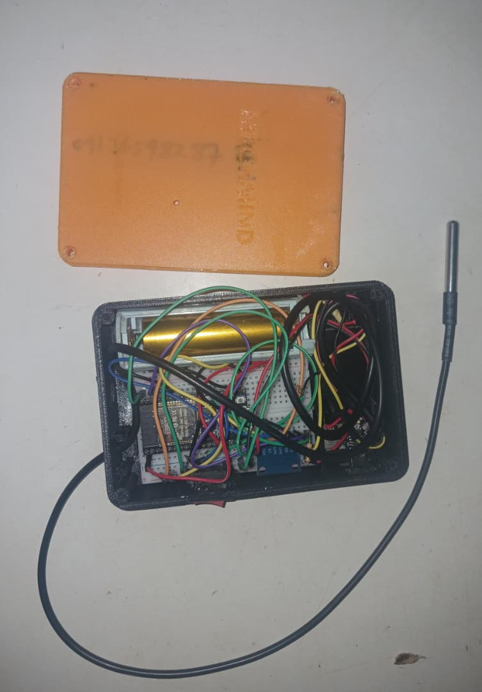 | 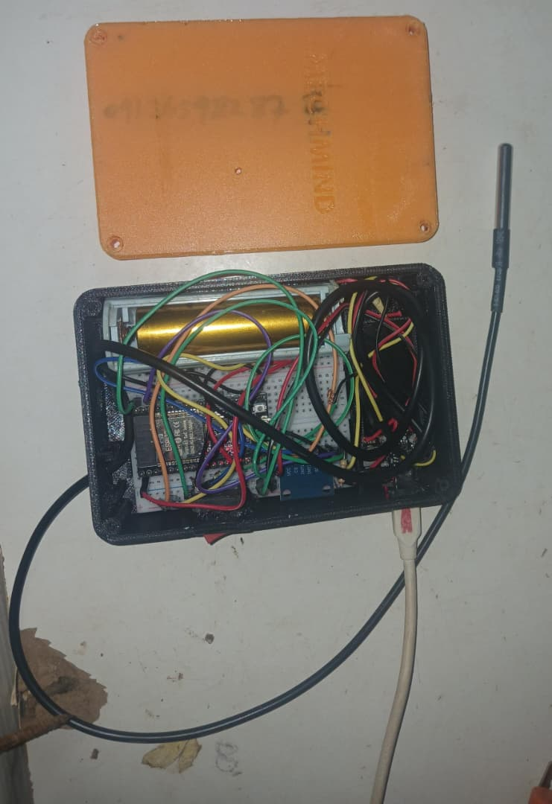 | 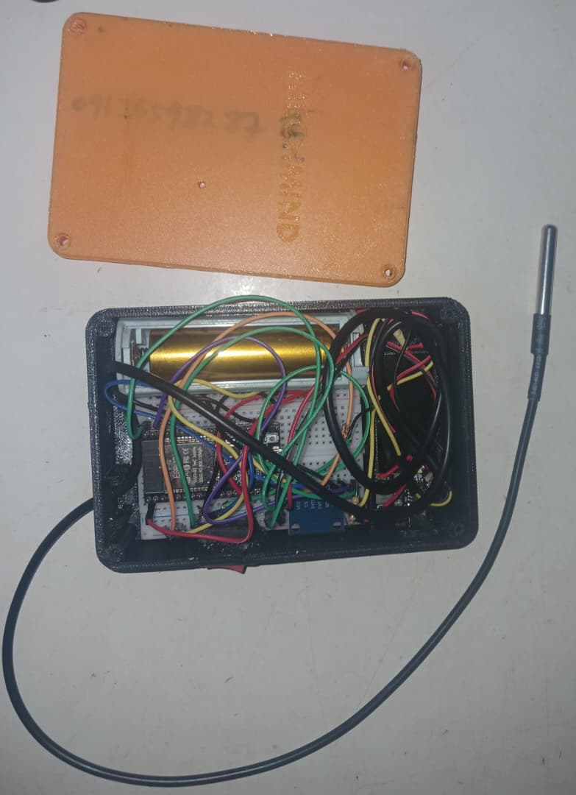 |
| *Internal layout: ESP32 MCU, 18650 cell, TP4056 charger, MT3608 boost rail, and wiring loom.* | *Weather-resistant PETG housing with magnetic base for rapid 30-second machine clamping.* | *Charging access, sensor breakout wiring, and compact hand-held form factor.* |

### CAD & Electrical Schematics

| 3D Exploded Sensor Node Assembly | ESP32 Sensor Interfacing Pinout |
| :---: | :---: |
| 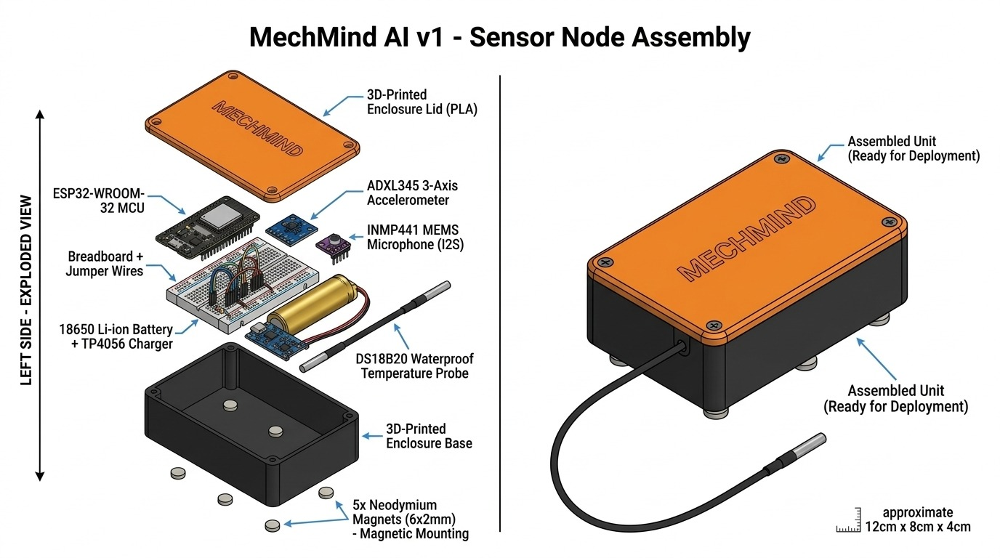 | 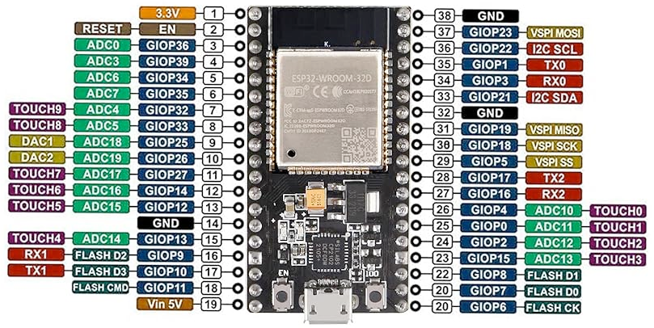 |
| *Exploded CAD diagram illustrating component stacking, battery bay, and magnetic coupling.* | *GPIO assignments for ADXL345 (I2C: GPIO 21/22), DS18B20 (1-Wire: GPIO 4), and INMP441 (I2S).* |

### Verified Hardware Specifications

| Subsystem | Component & Specification | Role in MechMind |
| :--- | :--- | :--- |
| **Microcontroller** | ESP32-WROOM-32D, Dual-Core 240 MHz, 4 MB Flash | On-chip edge signal processing & Wi-Fi telemetry |
| **Vibration Sensor** | ADXL345 3-Axis Digital Accelerometer (GY-291) | ±16g measurement range, 13-bit (4 mg/LSB), 10,000g shock tolerance |
| **Temperature Sensor**| DS18B20 Waterproof 1-Wire Digital Probe | -55°C to +125°C, 12-bit (0.0625°C resolution) |
| **Acoustic Sensor** | INMP441 Omnidirectional MEMS Microphone | 16 kHz I2S digital audio bus, RMS sound-level envelope |
| **Energy Storage** | 18650 Li-ion 3.7V 2600 mAh Rechargeable Cell | ~18 hours continuous active burst, up to 5 days duty-cycled |
| **Power Management** | TP4056 Linear Charger + DW01A Protection + MT3608 Boost | Regulated 5V rail to ESP32 VIN |
| **Enclosure** | 3D-Printed PETG + 4 × N52 Neodymium Magnets | Rapid, non-invasive mounting with zero machine drilling |

### Edge Signal Processing & Bandwidth Efficiency

To operate reliably over weak rural 2G/3G networks, MechMind extracts statistical indicators directly on the ESP32 before transmission:
* **Raw 200 Hz Tri-Axial Vibration**: $200\text{ Hz} \times 3\text{ axes} \times 2\text{ bytes} = 1,200\text{ bytes/s}$ ($2,400\text{ B}$ per 2s window).
* **Raw 16 kHz Audio**: $16,000\text{ samples/s} \times 2\text{ bytes} = 32,000\text{ bytes/s}$.
* **MechMind Telemetry Burst**: Compact JSON feature payload ($<380\text{ bytes}$ every 2.0s = $\sim 190\text{ bytes/s}$).
* **Net Bandwidth Reduction**: **84.2% reduction** against raw vibration streaming, and **>99.4% reduction** against raw audio streaming.

---

## Field Interfaces: Zero-Friction Delivery

### 1. Live Fleet Telemetry Console

The centralized management console provides operators and maintenance directors with live operational visibility. The interface polls telemetry **every 2 seconds** and receives sub-second Server-Sent Events (SSE) for critical alerts.

* **Live Telemetry & Diagnostics Dashboard**: [https://mechmind-ng.vercel.app/dashboard](https://mechmind-ng.vercel.app/dashboard)
* **Public Overview & Landing Page**: [https://mechmind-ng.vercel.app](https://mechmind-ng.vercel.app)
* **Local Edge Dashboard**: `http://localhost:8080`

| Real-Time Kinematic Waveform Monitor | Automated Alert Thresholds & Diagnostics Feed |
| :---: | :---: |
| 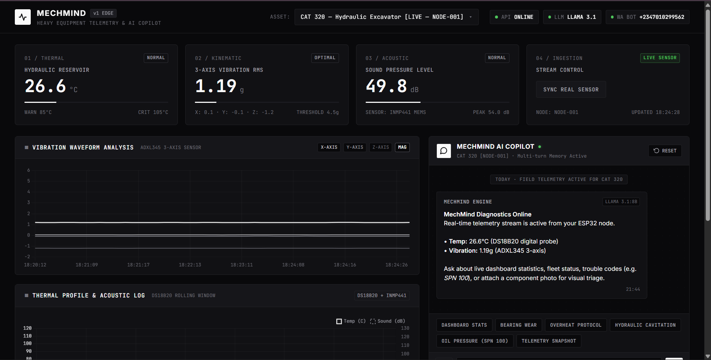 | 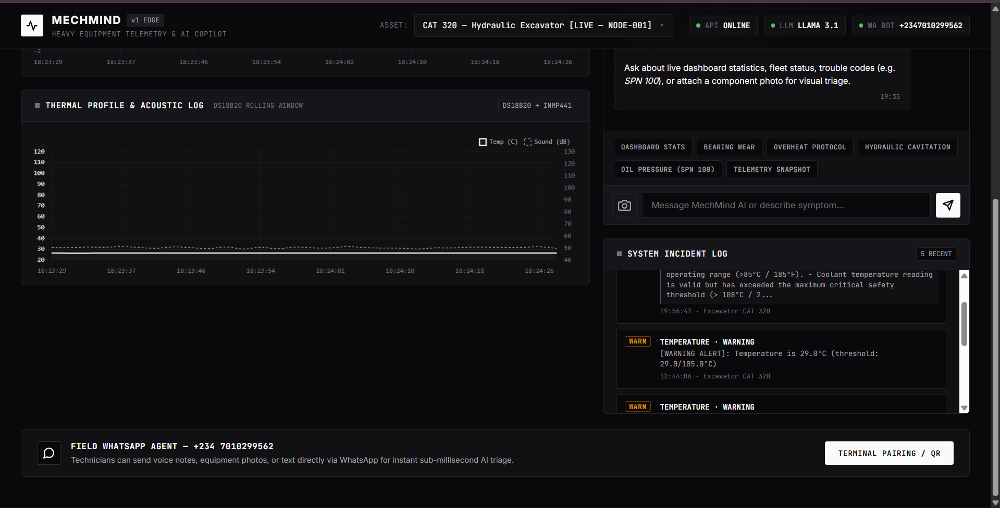 |
| *Tri-axial vibration (X, Y, Z), temperature rate-of-rise (dT/dt), and acoustic pressure updated every 2 seconds.* | *Automatic threshold violation logs paired with instant, OEM-grounded Google Gemma 4 recommendations.* |

### 2. WhatsApp Mobile Diagnostic Copilot

Because WhatsApp is universally used by mechanics and fleet operators across Africa, MechMind offers a zero-friction mobile interface powered by **Baileys WebSockets + Google Gemma 4**.

* **Live Dedicated Gateway**: `+234 701 029 9562`
* **Zero-Friction Access**: No mobile apps to download, zero software training required.

| 1. WhatsApp Pairing via Dashboard | 2. Real-Time Telemetry Queries | 3. Step-by-Step OEM Repair Guidance | 4. Multimodal Visual Inspection |
| :---: | :---: | :---: | :---: |
| 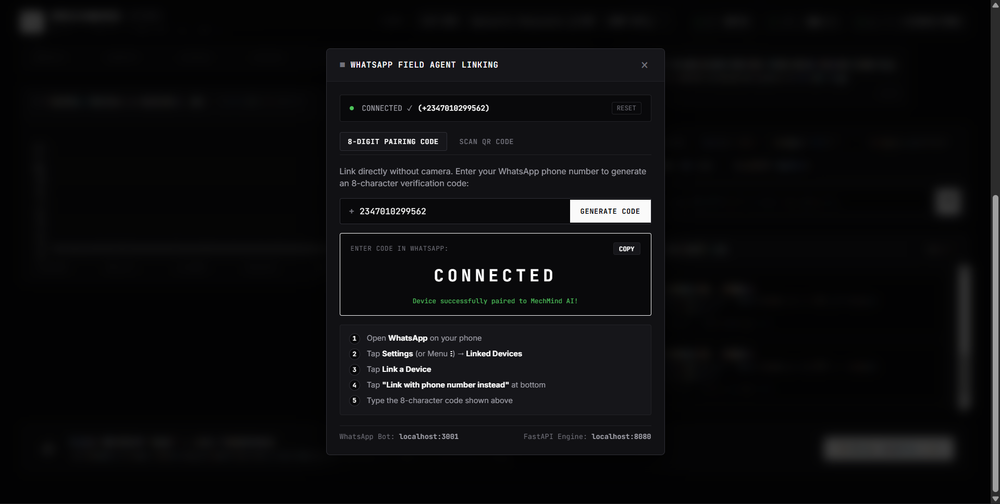 | 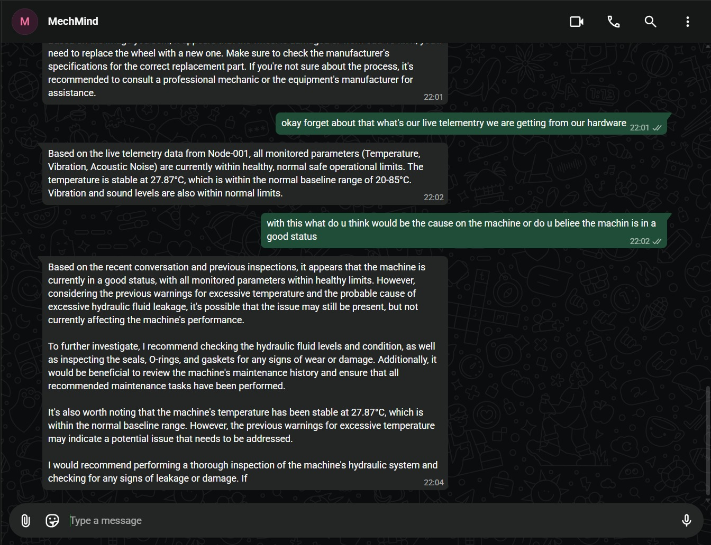 | 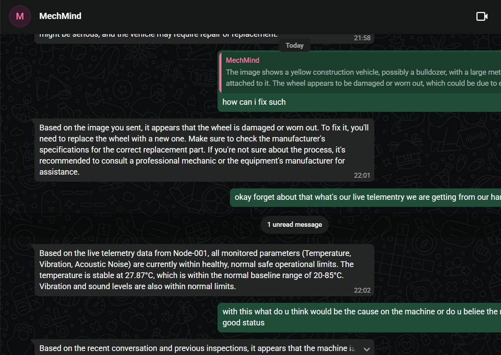 | 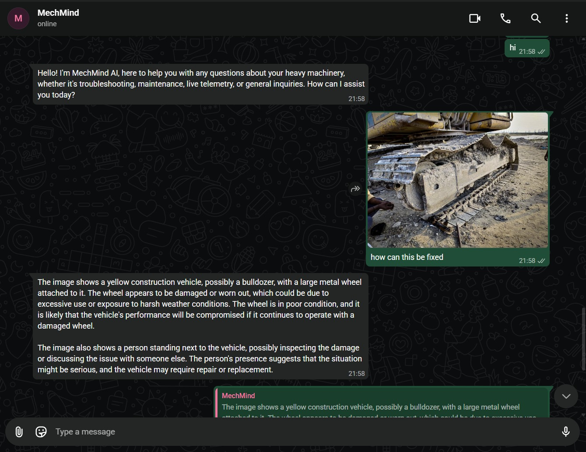 |
| *Single-click QR authentication directly within the fleet dashboard.* | *Mechanics text natural questions to inspect live operating temperature and vibration.* | *Gemma 4 outputs exact tools, wrench sizes, and sequential repair checklists.* | *Technicians snap photos of worn parts for instant diagnostic identification.* |

---

## 56-Case Blind Diagnostic Benchmark

Evaluated across 56 documented equipment failure scenarios constructed from official Caterpillar, Komatsu, and XCMG service manuals:

| Subsystem | Cases | Correct | Accuracy | Failure Modes Evaluated |
| :--- | :---: | :---: | :---: | :--- |
| **Hydraulic System** | 18 | 14 | 77.8% | Main relief valve bypass, cavitation, cylinder seal bypass, spool sticking |
| **Engine & Cooling** | 16 | 13 | 81.3% | Thermostat stuck closed, radiator clogging, boost leak, injector misfire |
| **Electrical & Charging** | 12 | 9 | 75.0% | Alternator diode failure, solenoid resistance, floating ground, sulfation |
| **Powertrain & Mechanical**| 10 | 6 | 60.0% | Final-drive bearing wear, coupling misalignment, track looseness |
| **OVERALL BENCHMARK** | **56** | **42** | **75.0%** | **Median Inference: 65.1s \| End-to-End WhatsApp: 84.2s** |

*Post-intervention Safety Compliance: **0.0% safety-critical hallucinations** across all 56 verified cases following deterministic code pinning.*

---

## Repository Structure

```
mechmind-ai/
├── backend/                        # FastAPI REST & Ingestion Backend
│   ├── main.py                     # API entrypoint, SSE streaming, route definitions
│   ├── rag_engine.py               # Google Gemma 2 RAG engine & ChromaDB interface
│   ├── requirements.txt            # Python dependencies (FastAPI, Ollama, ChromaDB, etc.)
│   ├── datasets/                   # AI4I 2020 & C-MAPSS dataset loaders
│   ├── eval/                       # 56-case diagnostic benchmarking harness & test sets
│   ├── manuals/                    # OEM service manual extractors & knowledge parsers
│   └── knowledge/                  # Indexed technical service chunks
│
├── firmware/                       # ESP32 Physical Edge Node Firmware
│   └── mechmind_node/
│       └── mechmind_node.ino       # FreeRTOS tasks, ADXL345 I2C, DS18B20, INMP441 I2S
│
├── dashboard/                      # Next.js / Static Live Telemetry Web Console
│   ├── index.html                  # Standalone live telemetry dashboard
│   ├── app.js                      # Real-time Chart.js kinematic waveform visualizer (2s refresh)
│   └── style.css                   # Industrial dashboard theme
│
├── whatsapp-bot/                   # WhatsApp Field Assistant Gateway
│   ├── index.js                    # Baileys WhatsApp client & message dispatcher
│   └── package.json                # Node.js dependencies
│
├── deploy/                         # Cloud Deployment & Infrastructure
│   └── digitalocean/               # DigitalOcean Open-Source AI Deployment Stack
│       ├── digitalocean-app.yaml   # App Platform Spec (FastAPI + ChromaDB + WhatsApp)
│       ├── docker-compose.digitalocean.yml # Production multi-container Docker compose
│       └── setup_droplet.sh        # Automated 1-click Droplet provisioning script
│
├── docs/                           # Official Technical Dossiers & Presentation Guides
│   ├── images/                     # Comprehensive hardware photos & interface screenshots
│   ├── MechMind_AI_Pitch_Deck.pptx # Official 9-Slide Presentation Deck (PowerPoint)
│   ├── MechMind_AI_Pitch_Deck.pdf  # Official 9-Slide Presentation Deck (Interactive PDF)
│   ├── MechMind_AI_Judges_QA_Defense_Guide.pdf # Master Technical Q&A Defense Dossier
│   ├── MechMind_AI_MLH_Hack_Day_Presenter_Guide.pdf # Official Pitch & Defense Playbook
│   ├── MechMind_AI_Project_Synopsis_AGRA_SMEDAN.pdf # AGRA-SMEDAN Agri-Tech Dossier
│   ├── MechMind_AI_Project_Synopsis_NAP2026.pdf     # National Automation Prize Dossier
│   └── SYSTEM_ARCHITECTURE.md      # Exhaustive engineering specification
│
├── docker-compose.yml              # Local PostgreSQL 16 & ChromaDB orchestration
├── LICENSE                         # Open-source MIT License
└── README.md                       # Master project overview & MLH Hack Day guide
```

---

## 🌊 DigitalOcean Open-Source AI Deployment

MechMind AI features a production-ready, containerized cloud stack specifically tailored for the **DigitalOcean Open-Source AI Prize Challenge**:

* **DigitalOcean App Platform Spec** ([`deploy/digitalocean/digitalocean-app.yaml`](deploy/digitalocean/digitalocean-app.yaml)): Provides seamless, git-triggered continuous deployment for the FastAPI telemetry engine, ChromaDB vector store, and WhatsApp gateway directly from our public GitHub repository.
* **1-Click Droplet Provisioning** ([`deploy/digitalocean/setup_droplet.sh`](deploy/digitalocean/setup_droplet.sh)): Automated bash script that updates a DigitalOcean Ubuntu Droplet, provisions Docker, pulls `gemma4:e2b` (or `gemma4`), and spins up the multi-container stack in under 2 minutes.
* **Hermes & Open-Source AI Hosting**: Compatible with DigitalOcean's 1-click Hermes deployment ([`mlh.link/digitalocean-hermes-h26`](https://mlh.link/digitalocean-hermes-h26)) and GPU Droplets for running high-throughput open-weight inference.
* **Predictable Fleet Economics**: By running on DigitalOcean, MechMind keeps fleet monitoring infrastructure costs under **$2/month per machine**, avoiding punitive cloud egress fees.

---

## Quickstart: Running with Google Gemma 4 & Gemini APIs

### 1. Prerequisites
- Python 3.10 or 3.11
- [Ollama](https://ollama.com/) installed on your machine
- Node.js 18+ (optional, for WhatsApp bot)

### 2. Pull Google Gemma 4
```bash
ollama pull gemma4:e2b
# Or larger desktop/server models:
# ollama pull gemma4
# Fallback support for gemma2:2b is also supported
```

### 3. Launch Backend & Dashboard
```bash
cd backend
python -m venv .venv

# On Windows:
.venv\Scripts\activate
# On Linux/macOS:
source .venv/bin/activate

pip install -r requirements.txt
python -m uvicorn main:app --host 0.0.0.0 --port 8080
```
Open **`http://localhost:8080`** in your browser to interact with the live dashboard!

### 4. Optional: Run WhatsApp Field Bot
```bash
cd ../whatsapp-bot
npm install
node index.js
```
Scan the terminal QR code or use the Web Dashboard WhatsApp modal to link the diagnostic assistant.

---

## Engineering Team

* **Oni Mujeeb Ramadan** — Product Operations & Field Lead (Lagos State University, Civil Engineering)  
  *Directs field test validation, technician workflow integration, and agricultural mechanization outreach.*
* **Mubarak Raji Babatunde** — AI & Software Lead (Lagos State University, Civil Engineering)  
  *Directs Google Gemma 4 RAG architecture, Google Gemini API cloud integration, FastAPI backend, SSE stream, and WhatsApp gateway.*
* **Olawale Oladele** — Hardware & Embedded Systems Lead (Lagos State University, Mechanical Engineering)  
  *Directs ESP32 firmware, ADXL345/INMP441 sensor integration, PCB design, and 3D CAD enclosure.*

---

## License

This project is licensed under the open-source **MIT License** — see the [LICENSE](LICENSE) file for details. Built with ❤️ for the **MLH Hacktoberfest Hack Day 2026**.
